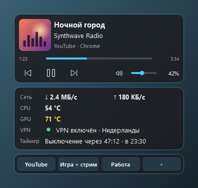
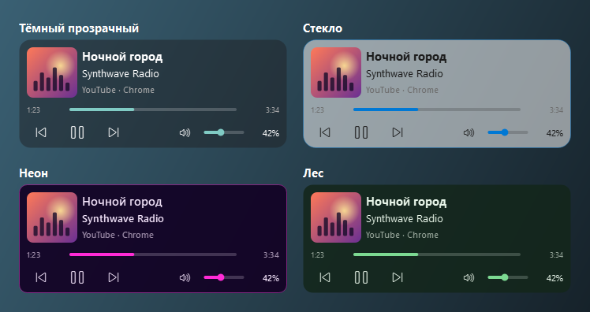
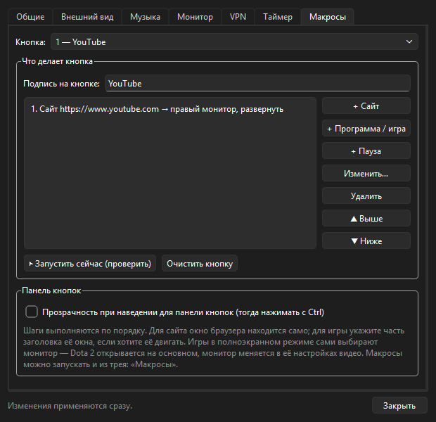

# DeskWidgets

Небольшие виджеты для рабочего стола Windows 11: что сейчас играет, скорость интернета, температура, таймер выключения и кнопки для быстрого запуска.

Сделал для себя, потому что надоело открывать по пять окон, чтобы узнать, какая песня играет в браузере и не греется ли видеокарта. Пользуйтесь, если пригодится — это бесплатно.

## Скачать

1. Откройте [последний релиз](../../releases/latest) и скачайте **DeskWidgets.exe**.
2. Положите его в любую папку (например, `Документы\DeskWidgets`) и запустите.

Устанавливать ничего не нужно, Python тоже не нужен.

**Windows может напугать окном «Система Windows защитила ваш компьютер».** Так бывает с любой программой без платной цифровой подписи. Нажмите «Подробнее» → «Выполнить в любом случае». Код открыт — можно посмотреть, что внутри.

## Что умеет

**Сейчас играет.** Показывает трек из ВК Музыки, YouTube, Spotify и всего, что играет в браузере или плеере: обложку, название, время. Можно поставить на паузу, переключить трек и поменять громкость ползунком или колесиком мыши.

**Монитор.** Скорость скачивания и отдачи, температура процессора и видеокарты (жёлтым и красным, если греется), включён ли VPN.

**Таймер выключения.** «Выключи компьютер через час» — в пару кликов из трея. Можно и по расписанию: например, в будни в 23:30. За 5 минут появится предупреждение с кнопками «+30 минут» и «Отменить». Если идёт игра или видео на весь экран, выключение подождёт.

**Кнопки-макросы.** Четыре кнопки, на каждую можно повесить что угодно. Например, одним нажатием запустить Доту на основном мониторе и открыть YouTube на втором.

**Темы.** 11 готовых тем и свои цвета. Выбрать можно прямо из меню, без настроек.

## Как пользоваться

После запуска в **трее** появится синяя иконка — это справа внизу у часов, иногда она прячется под стрелкой «^». Правый клик по ней открывает всё меню.

Несколько вещей, которые полезно знать сразу:

- **Когда наводишь мышь на виджет, он становится почти прозрачным** и не мешает кликать по тому, что под ним. Чтобы нажать кнопку на самом виджете, **держи Ctrl**. Если это мешает, выключается в настройках.
- **Подвинуть виджеты:** трей → «Режим редактирования». Тащите мышью, меняйте размер за углы, потом выключите режим. Виджеты прилипают к краям экрана и друг к другу.
- **Сменить тему:** трей → «Тема» (или правый клик по виджету).
- **Выключить компьютер позже:** трей → «Таймер выключения». Сколько осталось, видно на виджете «Монитор».
- **Настроить кнопку-макрос:** нажмите на пустую кнопку «+». Добавляйте шаги «Сайт», «Программа / игра», «Пауза» и выбирайте, на какой монитор отправить окно.
- **Запускать вместе с Windows:** Настройки → Общие.

Если у вас два монитора, виджеты по умолчанию встанут на второй. Отключили монитор — переедут на основной и не потеряются.

## Если что-то не так

**Не показывается трек.** Проверьте, видит ли его сама Windows: нажмите `Win + A`. Над громкостью должна быть плашка с треком. Если её нет, программа тоже ничего не увидит. Иногда помогает поставить на паузу и снова включить.

**Вместо температуры процессора написано «нужны права администратора».** Windows не даёт обычным программам читать датчики процессора. Скачайте [LibreHardwareMonitor](https://github.com/LibreHardwareMonitor/LibreHardwareMonitor/releases), создайте рядом с DeskWidgets.exe папку `lib` и положите туда все `.dll` из архива. Потом включите в настройках «Запускать от администратора». Окно с вопросом о правах появится один раз, дальше программа будет запускаться сама. Если не хочется возиться, можно просто выключить строку CPU в настройках.

**Не определяется VPN.** Включите VPN, затем Настройки → VPN → «Найти автоматически» и выберите свой VPN в списке.

**Виджет не нажимается.** Держите Ctrl (см. выше).

**Виджеты пропали.** Они прячутся, когда на мониторе что-то открыто на весь экран, и «Сейчас играет» прячется, когда ничего не играет. Если потерялись совсем: Настройки → Общие → «Сбросить положение виджетов».

**Всё сломалось.** Удалите папку `%APPDATA%\DeskWidgets` (вставьте это в адресную строку проводника) — программа начнёт с чистыми настройками. Там же лежит `log.txt`: если пишете о проблеме, приложите его, пожалуйста.

Нашли ошибку или есть идея — пишите в [Issues](../../issues).

## Для разработчиков

Программа написана на Python и PySide6. Как запустить из исходников, собрать .exe и как всё устроено внутри — в [docs/DEVELOPERS.md](docs/DEVELOPERS.md).

## Лицензия

MIT — можно бесплатно пользоваться, менять и делиться, в том числе в своих проектах. Подробности в файле [LICENSE](LICENSE).
